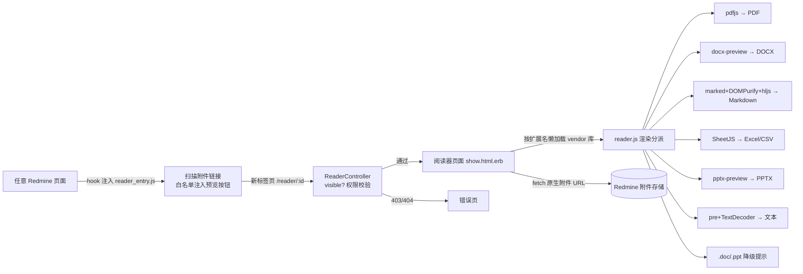

## 用户需求（原文重述）
基于 Redmine 6.1.x 开发一个文档在线阅读器插件（redmine_reader），支持以下格式的在线预览与浏览：docx、pdf、markdown、text、ppt、excel。阅读器须具备**通用访问能力**：无论文档存放于何处（项目文件库 Files、帮助与支持模块、issue 附件、文档/Wiki/论坛附件等），均可直接在线预览或浏览。**markdown 格式需额外渲染处理**，以正确展示格式化内容。项目根路径就是 /workspace，不额外创建项目文件夹（该仓库即插件本体，安装时置于 Redmine 的 plugins/redmine_reader）。

## 产品概览
一个 Redmine 6.1.x 插件：所有包含附件下载链接的页面自动出现「预览」入口，点击后在统一阅读器页面于浏览器端完成文档渲染，无需服务端转换组件、不新增 gem 依赖、无数据库迁移。已有文件（.cnb.yml、.cnb/、.codebuddy/、.gitignore）保持不动。

## 核心功能
- **通用预览入口**：自动识别各模块（文件库、issue、文档、Wiki、新闻、论坛）受支持格式的附件链接，追加预览图标按钮，新标签页打开阅读器
- **多格式在线渲染**：PDF（分页/缩放）、DOCX（保留样式）、Markdown（GFM：表格/任务列表/代码高亮）、文本（编码自适应）、PPTX（幻灯片浏览）、Excel（多工作表切换）
- **Markdown 专属渲染管线**：GFM 解析 → XSS 清洗 → 代码高亮
- **权限与安全**：仅当附件对当前用户可见时允许预览（403 拒绝），所有 HTML 注入一律经清洗
- **旧格式兜底**：.doc/.ppt（OLE 二进制）给出明确提示并保留下载链接
- **中英双语**界面文案


## Tech Stack Selection
- **宿主与后端**：Redmine 6.1.x 插件规范（Rails 7.2 / Ruby 3.2+，Zeitwerk 兼容），零新增 gem、零数据库迁移
- **前端**：原生 JavaScript + 自托管第三方库（下载至 assets，运行时不依赖外部 CDN）：
  - PDF → pdfjs-dist 3.11.x（UMD，含 pdf.worker.min.js）
  - DOCX → docx-preview（UMD dist；若依赖 JSZip 则附带 jszip.min.js）
  - Excel（xls/xlsx/xlsm/csv）→ SheetJS xlsx.full.min.js
  - Markdown → marked（GFM）+ DOMPurify（XSS 清洗）+ highlight.js（高亮）
  - PPTX → pptx-preview（纯前端预览库，UMMD dist）
  - 文本 → 原生 `<pre>` + TextDecoder（UTF-8 优先，失败回退 GBK）

## Implementation Approach
**轻量 Rails 侧 + 纯前端渲染**：插件只提供「一个预览页路由/控制器 + 一个全局视图 hook」，全部格式在浏览器解析。

关键决策：
1. **通用入口采用链接扫描**（而非逐页面 hook）：Redmine 所有模块的附件统一使用 `/attachments/download/:id/:filename` 形式链接；hook 注入约 4KB 的入口脚本扫描此类链接，按扩展名白名单注入「预览」按钮，天然覆盖文件库、issue、文档、Wiki、帮助与支持等任意现在及未来页面
2. **权限双重校验**：控制器用 `Attachment#visible?(User.current)` 拒绝未授权访问（403）；文件内容 fetch 走 Redmine 原生附件下载 URL（浏览器自带 session），插件不做代理，杜绝鉴权旁路
3. **Markdown 管线**：fetch 文本 → `marked.parse`（GFM：表格/任务列表/删除线）→ `DOMPurify.sanitize` → 注入 DOM → `hljs` 代码块高亮
4. **旧格式不做服务端转换**：.doc/.ppt（OLE 二进制）浏览器无法渲染，展示提示卡 + 下载兜底（避免引入 LibreOffice 重依赖）

**性能**：入口脚本全局仅几 KB（defer + 幂等）；阅读器页按格式**懒加载** vendor 库（查看 Markdown 不加载 pdfjs）；PDF 逐页渲染并让出主线程避免阻塞；后端仅单次 `Attachment.find`，无 N+1。

## Architecture Design


## Directory Structure
```
/workspace/                              # 仓库根 = Redmine 的 plugins/redmine_reader
├── .cnb.yml                             # [已有] 保持不动
├── .cnb/web_trigger.yml                 # [已有] 保持不动
├── .codebuddy/                          # [已有] 记忆体，保持不动
├── .gitignore                           # [已有] 保持不动
├── init.rb                              # [新建] 插件注册（requires_redmine 6.1）+ 加载 hooks
├── LICENSE                              # [新建] GPL-2.0（Redmine 插件惯例）
├── README.md                            # [新建] 安装/使用说明、支持格式表、权限说明
├── config/
│   ├── routes.rb                        # [新建] GET /reader/:attachment_id
│   └── locales/
│       ├── en.yml                       # [新建] 英文文案（按钮标签、错误提示）
│       └── zh.yml                       # [新建] 中文文案
├── app/
│   ├── controllers/
│   │   └── reader_controller.rb         # [新建] 查找附件、visible? 校验（403/404）、渲染页面
│   └── views/
│       ├── hooks/redmine_reader/
│       │   └── _head.html.erb           # [新建] 全局注入入口脚本与 i18n 配置
│       └── reader/
│           └── show.html.erb            # [新建] 预览页骨架（工具栏+视口+元数据 data 属性）
├── lib/
│   └── redmine_reader/
│       └── hooks.rb                     # [新建] ViewListener：view_layouts_base_html_head
├── assets/
│   ├── javascripts/
│   │   ├── reader_entry.js              # [新建] 全局链接扫描、预览按钮注入（幂等、Turbo 兼容）
│   │   ├── reader.js                   # [新建] 渲染分派 + 六类渲染器 + 懒加载器
│   │   └── vendor/                      # [新建] 自托管库（扁平命名，避免命中 .gitignore 的 dist/ 规则）
│   │       ├── pdf.min.js / pdf.worker.min.js
│   │       ├── docx-preview.min.js
│   │       ├── jszip.min.js             # [按需] docx-preview/pptx-preview 依赖
│   │       ├── xlsx.full.min.js
│   │       ├── marked.min.js
│   │       ├── purify.min.js
│   │       ├── highlight.min.js
│   │       └── pptx-preview.min.js
│   └── stylesheets/
│       ├── reader.css                   # [新建] 阅读器全部样式
│       └── vendor/github-dark.min.css   # [新建] 代码高亮主题
└── test/
    ├── functional/reader_controller_test.rb   # [新建] 权限、403/404、正常渲染
    └── integration/reader_flow_test.rb       # [新建] 登录后预览全流程
```

## Key Code Structures
```ruby
# init.rb —— 插件注册（Redmine 6 插件标准写法）
require_relative 'lib/redmine_reader/hooks'

Redmine::Plugin.register :redmine_reader do
  name 'Redmine Reader plugin'
  description '在线文档阅读器：docx/pdf/markdown/text/pptx/excel 全位置附件预览'
  version '1.0.0'
  requires_redmine version_or_higher: '6.1'
  url 'https://cnb.cool/xindu.site/redmine_reader'
end
```
```ruby
# config/routes.rb —— 预览路由
RedmineApp::Application.routes.draw do
  get 'reader/:attachment_id', to: 'reader#show', as: 'redmine_reader'
end
```

## Implementation Notes（执行要点）
- **Turbo 兼容**：Redmine 5.1+ 使用 Turbo，页面切换不再触发 DOMContentLoaded；reader_entry.js 需同时监听 `DOMContentLoaded` 与 `turbo:load`，并以 `data-reader-btn` 标记保证注入幂等
- **扩展名解析**：从链接 pathname 末段（`/attachments/download/:id/:filename`）取扩展名，缺失时回退用链接文本判断；白名单：pdf/docx/md/markdown/txt/log/csv/xls/xlsx/xlsm/pptx
- **安全**：所有 innerHTML 注入点一律先过 DOMPurify；纯文本用 textContent；控制器 403；文件本体经 Redmine 原生下载管道（session 鉴权）
- **编码兜底**：文本/markdown fetch 后先按 UTF-8 解码，`TextDecoder` fatal 失败再回退 GBK
- **vendor 自托管**：用 curl 从 jsdelivr/unpkg 下载 dist 单文件，扁平命名放入 vendor/（勿建 dist/ 目录，避免被 .gitignore 误杀）；docx-preview 与 pptx-preview 的确切 API 以各自 README 为准，渲染器封装为独立模块隔离差异，若需全局 JSZip 先加载 jszip.min.js
- **资产路径**：安装后经 `rake redmine:plugins:assets` 拷贝至 public，页面引用 `/plugin_assets/redmine_reader/...`
- **本地无 Redmine 宿主**：交付前用 `ruby -c`、`node --check` 全量语法校验；功能测试在目标 Redmine 环境执行
- **回滚半径**：不触碰已有 .cnb.yml/.cnb/.codebuddy/.gitignore；插件零迁移、零 gem，卸载即删目录


## 设计方案（阅读器页面，沿用 Redmine 默认布局与视觉语言）

### 页面区块（自上而下）
1. **顶部工具栏**：返回链接、文件名 + 类型徽章 + 大小、（PDF）缩放/适应宽度控件、右侧「下载」主按钮与「打印」次按钮；窄屏折叠为图标
2. **内容视口**：浅灰背景上的居中「纸张」容器（白底、圆角、细微阴影、最大宽度约束），文档在其中滚动
3. **格式专属视图**：
   - Markdown：GFM 完整排版——标题层级、斑马纹表格、任务列表复选框、引用块、深色围栏代码块 + 复制按钮
   - PDF：画布逐页渲染、页码指示、平滑滚动
   - Excel：底部工作表标签切换、表头吸顶、斑马纹行、横向滚动
   - PPTX：左侧幻灯片缩略图列表、右侧当前页视图、翻页控制
   - 文本：等宽字体 `<pre>`、自动换行开关
4. **状态区**：加载态（旋转指示器）、错误态（友好卡片 + 下载兜底链接）、旧格式降级提示卡
5. **列表页入口**：附件链接旁的小型预览图标按钮（悬浮微动效、title 提示），不改变原下载行为

交互细节：按钮 hover 轻微上浮 + 阴影加深；代码块复制按钮成功后短暂变绿；工作表/幻灯片切换有 150ms 过渡。


## Agent Extensions
### Skill
- **cnb-code-commit**
  - Purpose: 全部代码与测试完成后，使用该技能完成 git 首次提交（仓库当前 main 分支尚无提交，一并纳入既有 .cnb.yml、.cnb/、.codebuddy/、.gitignore 配置文件，使 CNB 同步按钮与记忆持久化机制同步生效）
  - Expected outcome: 插件完整代码与既有配置提交至 /workspace 仓库 main 分支，工作区干净
